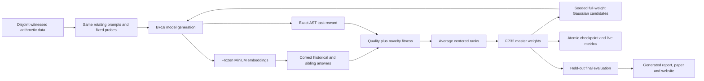

# Full-weight ES with LLM response novelty

This research project tests whether rewarding **correct but different answers** helps evolution strategies fine-tune a language model. It combines an adapted [ExTra](https://arxiv.org/abs/2606.24994) response-memory mechanism with full-weight optimization inspired by [ES at Scale](https://arxiv.org/abs/2509.24372). Each candidate is a small Gaussian perturbation of every unique model parameter; exact arithmetic grades its Countdown answers, and a frozen embedding model measures novelty among correct answers. The combination is an adaptation, not a reproduction of either paper.

**Status:** preregistration is published and the tested core pipeline is implemented. No model has been run and no positive or negative empirical result is claimed. The first experiment compares one main-method seed, one matched reward-only ES seed, and the untrained base model within twelve hours. Later multi-seed and scratch studies are gated on its report.



## Protocol and evidence

- [Preregistration](reports/preregistration.md): hypothesis, data hashes, primary metric, falsification, timing, controls and analysis.
- [Literature and source audit](docs/literature.md): LLM-specific alternatives, reuse, licenses and paper/code discrepancies.
- [Frozen initial configuration](configs/pilot.json), [data manifest](data/manifest.json), [roadmap](docs/roadmap.md).

The main endpoint is held-out greedy accuracy of the final scheduled checkpoint. The reward-only condition isolates the added novelty objective. The original checkpoint is the untrained baseline. Paired problem-bootstrap intervals describe uncertainty **conditional on one training seed**. They cannot establish robustness across seeds. Novelty reward, expression-tree diversity and harder-problem accuracy are secondary diagnostics. Results tables and figures will be generated from recorded artifacts, including incomplete runs and negative findings.

## Installation

Requires Python 3.12, [uv](https://docs.astral.sh/uv/), and a CUDA-capable GPU compatible with the locked PyTorch CUDA 13 build. The initial target is an RTX 5070 laptop with 8 GB VRAM. FP32 master weights stay in system RAM; inference uses BF16 and layer-sized perturbation buffers. The tested dependency versions are in `uv.lock`; no paid cloud service is used.

```powershell
git clone https://github.com/BurnyCoder/evolutionary-strategies-novelty-search-llm-training.git
cd evolutionary-strategies-novelty-search-llm-training
uv sync --locked
Copy-Item .env.example .env
uv run pytest
```

User-facing commands (publish and test the core before starting `run`):

```powershell
uv run novelty-es prepare
uv run novelty-es download
uv run novelty-es dashboard
uv run novelty-es run
# The same command resumes the same run and absolute deadline after interruption.
uv run novelty-es report
```

Run the dashboard in a second terminal at `http://127.0.0.1:8765`. The training terminal and JSONL files retain complete prompts and outputs. `.env`, caches, private credentials, intermediate weights and raw run directories are ignored by Git. Models and compact evaluation artifacts are published separately to one Hugging Face collection. See the [operations guide](docs/operations.md) for checkpoints, recovery, and artifact paths. [Generated report](reports/experiment-pilot.md) and [interactive result snapshot](https://BurnyCoder.github.io/evolutionary-strategies-novelty-search-llm-training/) explicitly identify missing or incomplete results.

## Method and reproducibility

Qwen2.5-0.5B-Instruct and all-MiniLM-L6-v2 are pinned by commit. The synthetic generator creates solvable arithmetic problems and prevents permutations or alternative targets for a number multiset from crossing splits. A restricted AST evaluator uses exact rational arithmetic and requires every supplied number exactly once. Task fitness averages both the rotating training batch and fixed training probes. Only exact correctness enables novelty; the smaller legality reward does not.

Each generation evaluates independent seeded Gaussian candidates. Main fitness combines task reward and nearest-neighbor semantic novelty; the control computes the same probe outputs and embeddings but updates from task reward alone. Average ranks handle ties without arbitrary ordering. Candidate reconstruction starts from the FP32 master to avoid cumulative BF16 add/subtract drift. Checkpoints preserve weights, RNGs, archive, cursor, configuration and the original deadline. The same seed schedules support a paired comparison; validation never selects the primary checkpoint.

Technologies: Python, PyTorch, Transformers, Sentence Transformers, NumPy, a standard-library local HTTP dashboard, Matplotlib, and ReportLab. The default pipeline is `prepare → calibrate → original → main → reward-only → held-out evaluation → report`. Details, deviations and experiment outcomes live in `docs/` and `reports/` rather than duplicated prose. See [NOTICE](NOTICE) for adapted code attribution and [LICENSE](LICENSE) for source terms.
