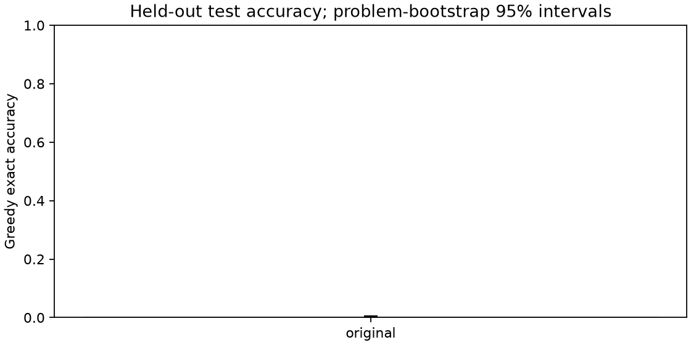
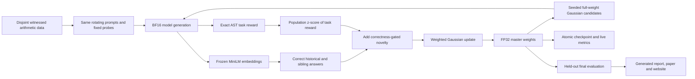

# Full-weight ES with LLM response novelty

This research project tests whether rewarding **correct but different answers** helps evolution strategies fine-tune a language model. It combines an adapted [ExTra](https://arxiv.org/abs/2606.24994) response-memory mechanism with full-weight optimization inspired by [ES at Scale](https://arxiv.org/abs/2509.24372). Each candidate is a small Gaussian perturbation of every unique model parameter; exact arithmetic grades its Countdown answers, and a frozen embedding model measures novelty among correct answers. The combination is an adaptation, not a reproduction of either paper.

The first local GPU experiment is complete: one main-method seed, one matched reward-only ES seed, and the original pretrained instruction model without task-specific updates here. Model execution finished within the persisted overall deadline. [Amendment A](reports/preregistration.md#amendment-a-source-aligned-weighting-before-either-trained-condition) preceded the first training generation but followed calibration and partial baseline evaluation. Later multi-seed and scratch studies remain planned. The generated results below and [full report](reports/experiment-pilot.md) retain the positive and negative findings.

A [registered longer continuation](reports/preregistration-continuation.md) extends both existing arms to generation 100 under the same training method, with a fresh disjoint primary evaluation set. An OS interruption stopped its control training, and that attempt's deadline expired. The separately [registered recovery](reports/preregistration-recovery.md) reused the completed main model and recorded recovery of the unfinished control state under a new bounded allowance, while retaining the interrupted evidence and original deadlines. The initial recovered control tensors were later overwritten, limiting independent verification. The fixed target and analysis do not depend on interim accuracy. See the [restoration and inspection commands](docs/continuation.md).

The recovered comparison is evaluated and published. Explore the [longer-training results](https://burnycoder.github.io/evolutionary-strategies-novelty-search-llm-training/continuation-seed0-gen100/), [paper](output/pdf/novelty-es-continuation-seed0-gen100.pdf), and [interpretation and limitations](reports/analysis-notes-continuation.md). Download the [novelty model](https://huggingface.co/BurnyCoder/novelty-es-qwen2.5-0.5b-main-seed0-gen100), [reward-only model](https://huggingface.co/BurnyCoder/novelty-es-qwen2.5-0.5b-reward-only-seed0-gen100), and [raw evidence](https://huggingface.co/datasets/BurnyCoder/novelty-es-continuation-seed0-gen100-artifacts). The [original publication receipt](reports/publication-continuation-seed0-gen100.json) pins predecessor revisions. The [independent corrections](reports/independent-corrections-2026-11-12.md) distinguish newly checked evidence from historical audit assertions and missing evidence. The first pilot remains a separate release below.

<!-- BEGIN GENERATED CONTINUATION RESULTS -->
The directional improvement hypothesis was not supported in this seed: main accuracy did not exceed reward-only ES. The paired interval includes zero, so this does not establish a performance difference.

Both arms improved over their earlier checkpoints when evaluated on the same fresh problems. Both trained checkpoints score higher than the original model on this test set; the main-versus-control comparison determines whether novelty adds a benefit. Both also produce more legal expressions on the three/four-number test problems. Legality alone does not mean the target was reached.

| Condition | Fresh greedy accuracy | 95% interval | Hard greedy accuracy | Original-test pass@1 | Original-test pass@8 | Status |
| --- | --- | --- | --- | --- | --- | --- |
| original | 0.24% | 0.05% - 0.49% | 0.10% | 0.12% | 0.89% | complete |
| main | 7.37% | 6.25% - 8.50% | 0.39% | 2.27% | 10.66% | complete |
| reward_only | 7.71% | 6.54% - 8.89% | 0.88% | 2.47% | 11.95% | complete |

Problem uncertainty conditional on one training seed; excludes seed variability. [Full report](reports/experiment-continuation-seed0-gen100.md).
<!-- END GENERATED CONTINUATION RESULTS -->

<!-- BEGIN GENERATED PILOT RESULTS -->
The directional improvement hypothesis was not supported in this seed: main accuracy did not exceed reward-only ES. The paired interval includes zero, so this does not establish a performance difference.

Both trained checkpoints score higher than the original model on this test set; the main-versus-control comparison determines whether novelty adds a benefit. Both also produce more legal expressions on the three/four-number test problems. Legality alone does not mean the target was reached. Both have lower expression validity on the five-number test problems than the original model, so the validity improvement does not transfer uniformly.

| Condition | Test greedy accuracy | 95% interval | Hard greedy accuracy | Original-test pass@1 | Original-test pass@8 | Status |
| --- | --- | --- | --- | --- | --- | --- |
| original | 0.29% | 0.10% - 0.54% | 0.10% | 0.12% | 0.89% | complete |
| main | 1.12% | 0.68% - 1.61% | 0.00% | 0.27% | 2.06% | complete |
| reward_only | 1.12% | 0.68% - 1.61% | 0.10% | 0.22% | 1.67% | complete |

Problem uncertainty conditional on one training seed; excludes seed variability. [Full report](reports/experiment-pilot.md).
<!-- END GENERATED PILOT RESULTS -->





## Protocol and evidence

- [Preregistration](reports/preregistration.md): hypothesis, data hashes, primary metric, falsification, timing, controls and analysis.
- [Literature and source audit](docs/literature.md): LLM-specific alternatives, reuse, licenses and paper/code discrepancies.
- [Source correspondence](docs/source-conformance.md): matching equations, retained differences and differential checks against pinned upstream code.
- [Historical initialization audits](reports/initialization-audits.json) and [historical final audit](reports/final-audit.json): retained records, not independent proof. Generation-zero snapshots are missing; see the [claim ledger](reports/claim-ledger.json).
- [Hugging Face research collection](https://huggingface.co/collections/BurnyCoder/evolution-strategies-with-llm-novelty-6aeef0a424ee9d502250b8ff): model exports and the raw evidence release.
- [Publication receipt](reports/publication.json) and [remote integrity checks](reports/publication-audit.json): immutable Hub revisions, exact file hashes and verified publication timing.
- [Amended training configuration](configs/pilot.json), [data manifest](data/manifest.json), [roadmap](docs/roadmap.md).

The main endpoint is held-out greedy accuracy of the final scheduled checkpoint. The reward-only condition isolates the added novelty objective under the recorded paired schedule. The original checkpoint is a pretrained baseline with no task-specific updates here. Paired problem-bootstrap intervals describe uncertainty **conditional on one training seed**. They cannot establish robustness across seeds. Sampled pass@k always uses the original-test subset, including in the continuation; it is not fresh-set accuracy. Novelty reward, expression-tree diversity and harder-problem accuracy are secondary diagnostics. Results tables and figures are generated from recorded artifacts, including failures and negative findings.

## Installation

Requires Python 3.12, [uv](https://docs.astral.sh/uv/), and a CUDA-capable GPU compatible with the locked PyTorch CUDA 13 build. The initial target is an RTX 5070 laptop with 8 GB VRAM. FP32 master weights stay in system RAM; inference uses BF16 and layer-sized perturbation buffers. The tested dependency versions are in `uv.lock`; no paid cloud service is used.

```powershell
git clone https://github.com/BurnyCoder/evolutionary-strategies-novelty-search-llm-training.git
cd evolutionary-strategies-novelty-search-llm-training
uv sync --locked
Copy-Item .env.example .env
uv run pytest
```

For inspection of the completed studies, follow the [pinned restoration workflow](docs/continuation.md), then:

```powershell
uv run novelty-es verify --pilot-dir artifacts/restored/pilot --continuation-dir artifacts/restored/continuation --data-dir data --fresh-dir data/continuation --output-root output/verification
uv run novelty-es report-all --pilot-dir artifacts/restored/pilot --continuation-dir artifacts/restored/continuation --output-root output/regenerated
uv run novelty-es dashboard --run-dir artifacts/restored/pilot
```

Run the dashboard in a second terminal at `http://127.0.0.1:8765`. The training terminal and JSONL files retain complete prompts and outputs. `.env`, caches, private credentials, intermediate weights and raw run directories are ignored by Git. Models, resumable FP32 checkpoints, complete generation traces and raw evaluations are published separately to one Hugging Face collection. See the [operations guide](docs/operations.md) for checkpoints, recovery, and artifact paths. The [generated report](reports/experiment-pilot.md) and [interactive results](https://BurnyCoder.github.io/evolutionary-strategies-novelty-search-llm-training/) show all conditions and evaluation coverage.

## Method and reproducibility

Qwen2.5-0.5B-Instruct and all-MiniLM-L6-v2 are [pinned by commit](configs/pilot.json). The [synthetic generator and verifier](src/novelty_es/data.py) create witnessed problems and isolate number multisets across splits. The accepted data distribution reflects rejection sampling, not uniform solvable problems. The verifier uses exact rational arithmetic, every supplied number exactly once, and restricted Python expression syntax. It accepts a bare expression or one answer tag, ignoring surrounding prose in the latter case. The [embedding model's pinned configuration](https://huggingface.co/sentence-transformers/all-MiniLM-L6-v2/blob/1110a243fdf4706b3f48f1d95db1a4f5529b4d41/sentence_bert_config.json) caps inputs at 256 WordPiece tokens including special tokens, even though complete response strings are passed to it. Task fitness averages the rotating training batch and fixed training probes. Only exact correctness enables novelty; the smaller legality reward does not.

Each generation evaluates independent seeded Gaussian candidates. Task rewards are standardized across the population following ES at Scale. The main condition adds correctness-gated nearest-neighbor novelty afterwards, following ExTra's normalization order; the control uses standardized task reward alone. No second normalization or ranking removes the bonus. The coefficient uses ExTra's reported default in normalized-quality units, without a claim that it is optimal for ES. Candidate reconstruction starts from the FP32 master to avoid cumulative BF16 add/subtract drift. Checkpoints preserve weights, RNGs, archive, cursor, configuration and the original deadline. The same seed schedules support a paired comparison; validation never selects the primary checkpoint.

[Amendment A](reports/preregistration.md#amendment-a-source-aligned-weighting-before-either-trained-condition) supersedes the original centered-rank rule. It was published after calibration and partial original-model evaluation, before either trained condition began. The raw coefficients support use of the amended rule from the first generation. The records describe original-pretrained initialization, but missing generation-zero tensors prevent an independent equality check today. [Source correspondence](docs/source-conformance.md) distinguishes equations from numerical and task adaptations.

Technologies: Python, PyTorch, Transformers, Sentence Transformers, NumPy, a standard-library local HTTP dashboard, Matplotlib, and ReportLab. The default pipeline is `prepare → calibrate → original → main → reward-only → held-out evaluation → report`. Details, deviations and experiment outcomes live in `docs/` and `reports/` rather than duplicated prose. See [NOTICE](NOTICE) for adapted code attribution and [LICENSE](LICENSE) for source terms.
