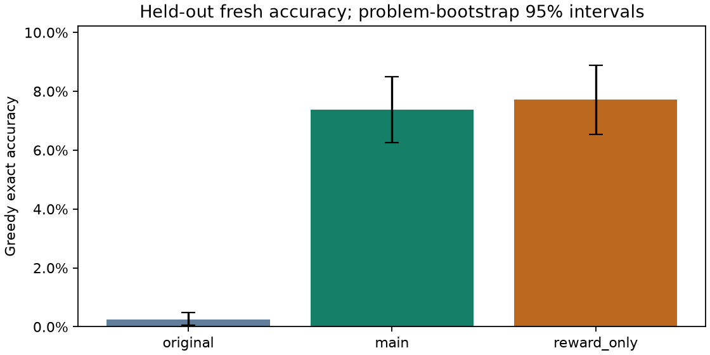
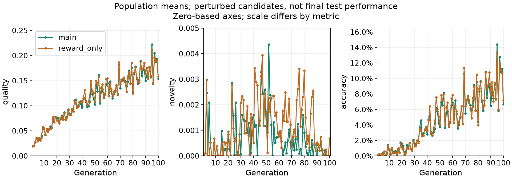

# continuation-seed0-gen100 experiment

Libor "Burny" Burian · 2026-11-12

This follow-up continues each arm's own generation-19 FP32 checkpoint to a fixed target of 100 generations, preserving the archive, RNGs and global schedules. The duration is the only training change. The original pilot was already observed and published. The new primary endpoint is the fresh 2048-problem set, excluding all earlier number multisets. The original test is secondary. Parent checkpoints receive fresh-only evaluation after continuation training, so the change contrast pairs four outcomes per problem. The earlier execution was interrupted after main generation 100 and control generation 31, with 19 candidates saved in the next control population. Its deadline (2026-11-08T18:50:55.807504+00:00) expired during the outage; that attempt remains incomplete. The separately registered recovery grants at most 10 hours, including 7 for unfinished control training and 3 for final work, capped by the original whole-week deadline. This amends the pretrained-stage allocation and may displace later studies. The main checkpoint is reused unchanged. Every non-metadata checkpoint field and saved pending candidate is preserved exactly. Training hours add the recorded active intervals before and after restart; the offline gap is excluded from compute time, but remains part of the expired attempt's wall-clock history. Model-execution elapsed time refers to the recovery clock. The earlier execution allowance was not met, regardless of recovery completion. Parent deadlines remain immutable. No stopping or checkpoint selection depends on interim accuracy. The untrained baseline's older outcomes are reused with their source hash; its fresh outcomes are newly evaluated. This is a single-seed, pilot-motivated follow-up, not a test of seed robustness.

| Condition | Parent fresh accuracy | Final fresh accuracy | Added generations | Added train tokens | Added train hours |
| --- | --- | --- | --- | --- | --- |
| main | 1.17% | 7.37% | 81 | 2322597 | 5.060 |
| reward_only | 1.27% | 7.71% | 81 | 2434805 | 5.138 |

A post-restart numerical diagnostic compared 16 naturally replayed GPU responses from the unfinished candidate. Exact response, token and verifier matches: True; mismatched rows: 0. Only timestamps and batch duration were excluded. This checks the observed candidate replay, not arbitrary hardware changes or a complete optimization trajectory.

The directional improvement hypothesis was not supported in this seed: main accuracy did not exceed reward-only ES. The paired interval includes zero, so this does not establish a performance difference.

Paired difference: -0.342 percentage points; 95% interval [-1.025, 0.342]; 2048 paired test problems.

Problem uncertainty conditional on one training seed; excludes seed variability.

Both arms improved over their earlier checkpoints when evaluated on the same fresh problems. Both trained checkpoints score higher than the original model on this test set; the main-versus-control comparison determines whether novelty adds a benefit. Both also produce more legal expressions on the three/four-number test problems. Legality alone does not mean the target was reached.

Percentile bootstrap intervals can collapse at observed boundaries or when paired outcomes are identical. A zero-width interval does not prove zero population error or equivalence on unseen problems.

| Condition | Fresh accuracy | 95% interval | Hard accuracy | pass@1 | pass@8 | Status |
| --- | --- | --- | --- | --- | --- | --- |
| original | 0.24% | 0.05% - 0.49% | 0.10% | 0.12% | 0.89% | complete |
| main | 7.37% | 6.25% - 8.50% | 0.39% | 2.27% | 10.66% | complete |
| reward_only | 7.71% | 6.54% - 8.89% | 0.88% | 2.47% | 11.95% | complete |

original: greedy problems fresh 2048/2048, test 2048/2048, hard 1024/1024, probes 16/16; sampled complete problems 256/256. main: greedy problems fresh 2048/2048, test 2048/2048, hard 1024/1024, probes 16/16; sampled complete problems 256/256. reward_only: greedy problems fresh 2048/2048, test 2048/2048, hard 1024/1024, probes 16/16; sampled complete problems 256/256.

| Comparison | Difference (pp) | Paired 95% interval (pp) | Problems |
| --- | --- | --- | --- |
| Main - reward-only (primary) | -0.342 | [-1.025, 0.342] | 2048 |
| main - original (secondary) | 7.129 | [5.957, 8.301] | 2048 |
| reward_only - original (secondary) | 7.471 | [6.299, 8.691] | 2048 |
| main: final - parent (secondary) | 6.201 | [4.932, 7.422] | 2048 |
| reward_only: final - parent (secondary) | 6.445 | [5.176, 7.715] | 2048 |
| Difference in changes (secondary) | -0.244 | [-0.977, 0.488] | 2048 |
| Old-test main - control (secondary) | -0.586 | [-1.172, -0.049] | 2048 |

All comparisons other than the final main-minus-control primary endpoint are descriptive secondary estimates with unadjusted intervals.





## Probe performance, validity and resources

| Condition | Probe accuracy | Fresh validity | Hard validity | Train tokens | Eval tokens | Train hours |
| --- | --- | --- | --- | --- | --- | --- |
| original | 0.00% | 29.74% | 10.64% | 0 | 481714 | 0.000 |
| main | 18.75% | 95.75% | 72.56% | 3121272 | 202961 | 5.060 |
| reward_only | 18.75% | 95.85% | 76.46% | 3249607 | 198224 | 5.138 |

Train tokens count only candidates in committed generations; evaluation tokens count persisted evaluation responses. Calibration, validation, interrupted batches and replay costs are excluded from those columns. Training hours include phase overhead and checkpointing. Training tokens in this diagnostic table are cumulative, whereas training hours and the earlier added-token column cover this continuation only. The original model's older evaluation outcomes and token counts are reused from the pinned parent release. Probes are training examples, not held-out data.

## Novelty intervention diagnostic

Descriptive diagnostic: compare the main arm's Z(Q) + 1.0 N with Z(Q) on its recorded populations. The control computes novelty but applies coefficient zero, so its novelty-induced weight changes are zero. This local comparison does not simulate the counterfactual training trajectory. main: positive novelty in 225 of 3000 candidates; changed update weights in 79 of 100 generations (182 candidate weights). reward_only: positive novelty in 306 of 3000 candidates; changed update weights in 0 of 100 generations (0 candidate weights).

See [analysis notes](analysis-notes.md) for when this descriptive check was added.

## Within-problem expression diversity

| Condition | Greedy correct structures | Complete sampled problems | Mean correct structures / sampled problem |
| --- | --- | --- | --- |
| original | 5 | 256 | 0.0156 |
| main | 151 | 256 | 0.1992 |
| reward_only | 158 | 256 | 0.2188 |

Greedy structure counts equal successful problems, since each problem has one response. Sampled diversity counts distinct correct canonical ASTs within each problem, then averages over complete sampled groups, including zeros. This is syntactic diversity; algebraically equivalent expressions may count separately.

## Method and scope

See the [preregistration](preregistration-recovery.md), [configuration](../configs/continuation-recovery.json), [data hashes](../data/manifest.json), and [literature audit](../docs/literature.md). This is an adaptation of [ExTra](https://arxiv.org/abs/2606.24994) and [ES at Scale](https://arxiv.org/abs/2509.24372), not a reproduction. The archive gate uses exact correctness; positive legality reward is insufficient. Validation does not choose the final checkpoint. Amendment A replaces combined-reward ranks with population-z-scored task reward plus post-normalization novelty. It was published after calibration and partial original-model evaluation, before either trained condition. Both pilot arms started from original pretrained weights using the amended rule from generation one.

Qwen/Qwen2.5-0.5B-Instruct: 24 layers, width 896, 14 query heads and 2 key/value heads; 494,032,768 unique parameter elements in 290 tensors. Architecture and counts come from the pinned pretrained files and the generation-zero checkpoint audit.

## Recorded measurements

All values below come from persisted outcomes. Missing conditions remain missing. Population training accuracy is distinct from unperturbed master validation and held-out test accuracy.

```json
{
  "methods": {
    "original": {
      "training_complete": true,
      "evaluation_seconds": 921.3584784999912,
      "complete": true,
      "fresh": {
        "n": 2048,
        "expected": 2048,
        "complete": true,
        "accuracy": 0.00244140625,
        "interval": [
          0.00048828125,
          0.0048828125
        ],
        "validity": 0.29736328125,
        "reward": 0.031933593749999996,
        "generated_tokens": 96593,
        "truncated": 531,
        "correct_expression_structures": 5
      },
      "test": {
        "n": 2048,
        "expected": 2048,
        "complete": true,
        "accuracy": 0.0029296875,
        "interval": [
          0.0009765625,
          0.00537109375
        ],
        "validity": 0.29296875,
        "reward": 0.03193359375,
        "generated_tokens": 95929,
        "truncated": 529,
        "correct_expression_structures": 6
      },
      "hard": {
        "n": 1024,
        "expected": 1024,
        "complete": true,
        "accuracy": 0.0009765625,
        "interval": [
          0.0,
          0.0029296875
        ],
        "validity": 0.1064453125,
        "reward": 0.0115234375,
        "generated_tokens": 59320,
        "truncated": 333,
        "correct_expression_structures": 1
      },
      "probes": {
        "n": 16,
        "expected": 16,
        "complete": true,
        "accuracy": 0.0,
        "interval": [
          0.0,
          0.0
        ],
        "validity": 0.25,
        "reward": 0.025,
        "generated_tokens": 823,
        "truncated": 5,
        "correct_expression_structures": 0
      },
      "sampled": {
        "complete_problems": 256,
        "expected": 256,
        "generated_tokens": 229049,
        "partial_problems": 0,
        "pass1": 0.001220703125,
        "pass8": 0.008854166666666666,
        "mean_unique_correct_structures": 0.015625
      },
      "training": {},
      "training_observations": {
        "responses": 0,
        "generated_tokens": 0,
        "truncated": 0,
        "weight_diagnostic": {
          "generations_observed": 0,
          "candidates_observed": 0,
          "candidates_positive_novelty": 0,
          "generations_positive_novelty": 0,
          "generations_weight_changed": 0,
          "candidates_weight_changed": 0,
          "largest_absolute_weight_change": 0.0
        }
      },
      "added_training_observations": {
        "generations": 0,
        "responses": 0,
        "generated_tokens": 0,
        "truncated": 0,
        "weight_diagnostic": {
          "generations_observed": 0,
          "candidates_observed": 0,
          "candidates_positive_novelty": 0,
          "generations_positive_novelty": 0,
          "generations_weight_changed": 0,
          "candidates_weight_changed": 0,
          "largest_absolute_weight_change": 0.0
        }
      },
      "training_seconds": 0.0
    },
    "main": {
      "training_complete": true,
      "evaluation_seconds": 1475.9445502000417,
      "complete": true,
      "fresh": {
        "n": 2048,
        "expected": 2048,
        "complete": true,
        "accuracy": 0.07373046875,
        "interval": [
          0.0625,
          0.0849609375
        ],
        "validity": 0.95751953125,
        "reward": 0.162109375,
        "generated_tokens": 37878,
        "truncated": 0,
        "correct_expression_structures": 151
      },
      "test": {
        "n": 2048,
        "expected": 2048,
        "complete": true,
        "accuracy": 0.06591796875,
        "interval": [
          0.05565185546875001,
          0.07666015625
        ],
        "validity": 0.95947265625,
        "reward": 0.15527343750000003,
        "generated_tokens": 37938,
        "truncated": 0,
        "correct_expression_structures": 135
      },
      "hard": {
        "n": 1024,
        "expected": 1024,
        "complete": true,
        "accuracy": 0.00390625,
        "interval": [
          0.0009765625,
          0.0078125
        ],
        "validity": 0.7255859375,
        "reward": 0.07607421875,
        "generated_tokens": 24438,
        "truncated": 0,
        "correct_expression_structures": 4
      },
      "probes": {
        "n": 16,
        "expected": 16,
        "complete": true,
        "accuracy": 0.1875,
        "interval": [
          0.0,
          0.375
        ],
        "validity": 0.9375,
        "reward": 0.2625,
        "generated_tokens": 272,
        "truncated": 0,
        "correct_expression_structures": 3
      },
      "sampled": {
        "complete_problems": 256,
        "expected": 256,
        "generated_tokens": 102435,
        "partial_problems": 0,
        "pass1": 0.022705078125,
        "pass8": 0.10664214257964258,
        "mean_unique_correct_structures": 0.19921875
      },
      "training": {
        "generation": 100,
        "generations": 100,
        "complete": true,
        "generated_tokens": 3121272,
        "responses": 144000
      },
      "training_observations": {
        "responses": 144000,
        "generated_tokens": 3121272,
        "truncated": 2632,
        "weight_diagnostic": {
          "generations_observed": 100,
          "candidates_observed": 3000,
          "candidates_positive_novelty": 225,
          "generations_positive_novelty": 82,
          "generations_weight_changed": 79,
          "candidates_weight_changed": 182,
          "largest_absolute_weight_change": 0.0625
        }
      },
      "added_training_observations": {
        "generations": 81,
        "responses": 116640,
        "generated_tokens": 2322597,
        "truncated": 633,
        "weight_diagnostic": {
          "generations_observed": 81,
          "candidates_observed": 2430,
          "candidates_positive_novelty": 210,
          "generations_positive_novelty": 72,
          "generations_weight_changed": 70,
          "candidates_weight_changed": 168,
          "largest_absolute_weight_change": 0.0625
        }
      },
      "training_seconds": 18217.73824429512
    },
    "reward_only": {
      "training_complete": true,
      "evaluation_seconds": 1425.0720548000572,
      "complete": true,
      "fresh": {
        "n": 2048,
        "expected": 2048,
        "complete": true,
        "accuracy": 0.0771484375,
        "interval": [
          0.0654296875,
          0.0888671875
        ],
        "validity": 0.95849609375,
        "reward": 0.165283203125,
        "generated_tokens": 37659,
        "truncated": 0,
        "correct_expression_structures": 158
      },
      "test": {
        "n": 2048,
        "expected": 2048,
        "complete": true,
        "accuracy": 0.07177734375,
        "interval": [
          0.06103515625,
          0.08349609375
        ],
        "validity": 0.96484375,
        "reward": 0.16108398437500004,
        "generated_tokens": 37793,
        "truncated": 0,
        "correct_expression_structures": 147
      },
      "hard": {
        "n": 1024,
        "expected": 1024,
        "complete": true,
        "accuracy": 0.0087890625,
        "interval": [
          0.00390625,
          0.0146484375
        ],
        "validity": 0.7646484375,
        "reward": 0.08437499999999999,
        "generated_tokens": 24653,
        "truncated": 0,
        "correct_expression_structures": 9
      },
      "probes": {
        "n": 16,
        "expected": 16,
        "complete": true,
        "accuracy": 0.1875,
        "interval": [
          0.0,
          0.375
        ],
        "validity": 1.0,
        "reward": 0.26875000000000004,
        "generated_tokens": 276,
        "truncated": 0,
        "correct_expression_structures": 3
      },
      "sampled": {
        "complete_problems": 256,
        "expected": 256,
        "generated_tokens": 97843,
        "partial_problems": 0,
        "pass1": 0.024658203125,
        "pass8": 0.11948450854700854,
        "mean_unique_correct_structures": 0.21875
      },
      "training": {
        "generation": 100,
        "generations": 100,
        "complete": true,
        "generated_tokens": 3249607,
        "responses": 144000
      },
      "training_observations": {
        "responses": 144000,
        "generated_tokens": 3249607,
        "truncated": 2653,
        "weight_diagnostic": {
          "generations_observed": 100,
          "candidates_observed": 3000,
          "candidates_positive_novelty": 306,
          "generations_positive_novelty": 85,
          "generations_weight_changed": 0,
          "candidates_weight_changed": 0,
          "largest_absolute_weight_change": 0.0
        }
      },
      "added_training_observations": {
        "generations": 81,
        "responses": 116640,
        "generated_tokens": 2434805,
        "truncated": 560,
        "weight_diagnostic": {
          "generations_observed": 81,
          "candidates_observed": 2430,
          "candidates_positive_novelty": 293,
          "generations_positive_novelty": 76,
          "generations_weight_changed": 0,
          "candidates_weight_changed": 0,
          "largest_absolute_weight_change": 0.0
        }
      },
      "training_seconds": 18496.86279273033,
      "training_seconds_before_restart": 4067.6375501155853
    }
  },
  "elapsed_seconds": 19017.62396979332,
  "calibration": {
    "generations": 100,
    "batch_size": 16,
    "source": "registered parent timing; no new calibration or weight updates",
    "observed_max_generation_seconds": 443.61523640000087,
    "checkpoint_seconds": 5.704658999999083,
    "estimated_generation_seconds": 449.31989539999995,
    "added_generations": 81,
    "predicted_training_seconds_per_arm": 36394.91152739999,
    "fraction_of_training_cap": 0.7776690497307691,
    "rule": "Fixed target 100; 81 added updates fit 80% of each 13-hour cap using the parent maximum plus checkpoint cost."
  },
  "logged_generation_work": [
    {
      "condition": "main",
      "phase": "evaluation",
      "responses": 9232,
      "generated_tokens": 202961
    },
    {
      "condition": "main",
      "phase": "train",
      "responses": 116640,
      "generated_tokens": 2322597
    },
    {
      "condition": "main",
      "phase": "validation",
      "responses": 1088,
      "generated_tokens": 20564
    },
    {
      "condition": "original",
      "phase": "evaluation",
      "responses": 2048,
      "generated_tokens": 96593
    },
    {
      "condition": "parent_main",
      "phase": "evaluation",
      "responses": 2048,
      "generated_tokens": 41626
    },
    {
      "condition": "parent_reward_only",
      "phase": "evaluation",
      "responses": 2048,
      "generated_tokens": 42417
    },
    {
      "condition": "reward_only",
      "phase": "evaluation",
      "responses": 9232,
      "generated_tokens": 198224
    },
    {
      "condition": "reward_only",
      "phase": "train",
      "responses": 116656,
      "generated_tokens": 2435230
    },
    {
      "condition": "reward_only",
      "phase": "validation",
      "responses": 1088,
      "generated_tokens": 21023
    }
  ]
}
```

## Failures, deviations and learnings

```json
{
  "failures": [],
  "protocol_amendments": [],
  "execution_repairs": [],
  "recovery_audit": {},
  "initial_code_revision": "93a409e91387830d24c39c919e78123e94c29790",
  "training_code_revision": "66884b2e7dcbd3f1f633554674dcd61faf2954e2"
}
```

The first audit reconciled ExTra's correctness-filtered paper specification with its unfiltered embedding-memory insertion. Explicit Boolean masking and separate score/append operations implement the intended experiment. FP32 master reconstruction avoids repeated BF16 perturbation subtraction. Tests exercise interrupted candidate replay, archive RNG restoration, deadline preservation and exact arithmetic. Hyperparameters are preregistered choices, not claimed optima. Further training requires reviewing this pilot.

## Limitations

One seed; synthetic arithmetic; embedding-proxy and probe-overfitting risks; no general-language benchmark; descriptive secondary analyses. Bootstrap intervals omit seed variability. CPU tests, reporting, audits and backups overlapped training, so timing is not an isolated systems benchmark.
