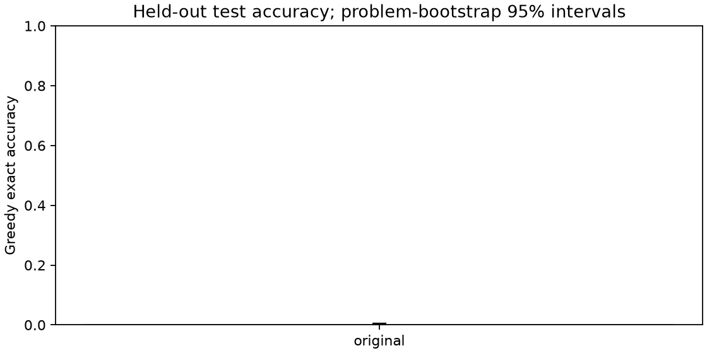
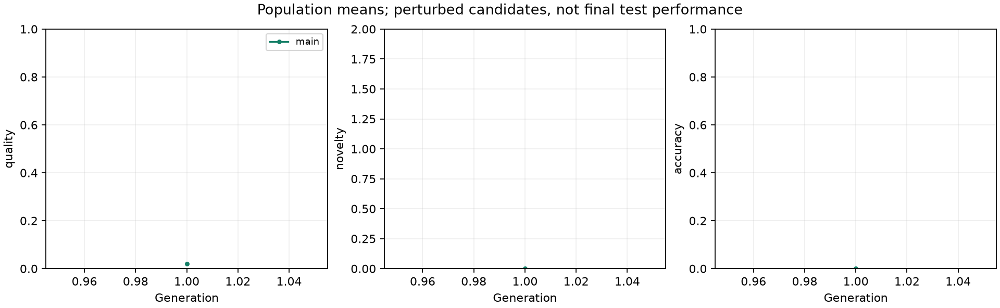

# Pilot experiment

Libor "Burny" Burian · 2026-11-07

No completed paired primary endpoint is available.

The registered paired endpoint is incomplete or not yet available.

Problem uncertainty conditional on one training seed; excludes seed variability.

Percentile bootstrap intervals can collapse at observed boundaries or when paired outcomes are identical. A zero-width interval does not prove zero population error or equivalence on unseen problems.

| Condition | Test accuracy | 95% interval | Hard accuracy | pass@1 | pass@8 | Status |
| --- | --- | --- | --- | --- | --- | --- |
| original | 0.29% | 0.10% - 0.54% | 0.10% | 0.16% | 1.16% | incomplete |
| main | missing | missing | missing | missing | missing | incomplete |
| reward_only | missing | missing | missing | missing | missing | incomplete |

original: greedy problems test 2048/2048, hard 1024/1024, probes 16/16; sampled complete problems 196/256. main: greedy problems test 0/2048, hard 0/1024, probes 0/16; sampled complete problems 0/256. reward_only: greedy problems test 0/2048, hard 0/1024, probes 0/16; sampled complete problems 0/256.





## Probe performance, validity and resources

| Condition | Probe accuracy | Test validity | Hard validity | Train tokens | Eval tokens | Train hours |
| --- | --- | --- | --- | --- | --- | --- |
| original | 0.00% | 29.30% | 10.64% | 0 | 330933 | 0.000 |
| main | missing | missing | missing | 70068 | 0 | 0.185 |
| reward_only | missing | missing | missing | 0 | 0 | 0.000 |

Train tokens count only candidates in committed generations; evaluation tokens count persisted evaluation responses. Calibration, validation, interrupted batches and replay costs are excluded from those columns. Training hours include phase overhead and checkpointing. Probes are training examples, not held-out data.

## Novelty intervention diagnostic

Descriptive diagnostic: compare Z(Q) + 1.0 N with Z(Q) on each recorded population. This local comparison does not simulate the counterfactual training trajectory. main: positive novelty in 0 of 30 candidates; changed update weights in 0 of 1 generations (0 candidate weights).

See [analysis notes](analysis-notes.md) for when this descriptive check was added.

## Within-problem expression diversity

| Condition | Greedy correct structures | Complete sampled problems | Mean correct structures / sampled problem |
| --- | --- | --- | --- |
| original | 6 | 196 | 0.0204 |
| main | missing | 0 | missing |
| reward_only | missing | 0 | missing |

Greedy structure counts equal successful problems, since each problem has one response. Sampled diversity counts distinct correct canonical ASTs within each problem, then averages over complete sampled groups, including zeros. This is syntactic diversity; algebraically equivalent expressions may count separately.

## Method and scope

See the [preregistration](preregistration.md), [configuration](../configs/pilot.json), [data hashes](../data/manifest.json), and [literature audit](../docs/literature.md). This is an adaptation of [ExTra](https://arxiv.org/abs/2606.24994) and [ES at Scale](https://arxiv.org/abs/2509.24372), not a reproduction. The archive gate uses exact correctness; positive legality reward is insufficient. Validation does not choose the final checkpoint. Amendment A replaces combined-reward ranks with population-z-scored task reward plus post-normalization novelty. It was published after calibration and partial original-model evaluation, before either trained condition. Both trained arms start from original pretrained weights using the amended rule from generation one.

Qwen/Qwen2.5-0.5B-Instruct: 24 layers, width 896, 14 query heads and 2 key/value heads; 494,032,768 unique parameter elements in 290 tensors. Architecture and counts come from the pinned pretrained files and the generation-zero checkpoint audit.

## Recorded measurements

All values below come from persisted outcomes. Missing conditions remain missing. Population training accuracy is distinct from unperturbed master validation and held-out test accuracy.

```json
{
  "methods": {
    "original": {
      "training_complete": true,
      "evaluation_seconds": 2658.674874499993,
      "complete": false,
      "test": {
        "n": 2048,
        "expected": 2048,
        "complete": true,
        "accuracy": 0.0029296875,
        "interval": [
          0.0009765625,
          0.00537109375
        ],
        "validity": 0.29296875,
        "reward": 0.03193359375,
        "generated_tokens": 95929,
        "truncated": 529,
        "correct_expression_structures": 6
      },
      "hard": {
        "n": 1024,
        "expected": 1024,
        "complete": true,
        "accuracy": 0.0009765625,
        "interval": [
          0.0,
          0.0029296875
        ],
        "validity": 0.1064453125,
        "reward": 0.0115234375,
        "generated_tokens": 59320,
        "truncated": 333,
        "correct_expression_structures": 1
      },
      "probes": {
        "n": 16,
        "expected": 16,
        "complete": true,
        "accuracy": 0.0,
        "interval": [
          0.0,
          0.0
        ],
        "validity": 0.25,
        "reward": 0.025,
        "generated_tokens": 823,
        "truncated": 5,
        "correct_expression_structures": 0
      },
      "sampled": {
        "complete_problems": 196,
        "expected": 256,
        "generated_tokens": 174861,
        "partial_problems": 0,
        "pass1": 0.0015943877551020409,
        "pass8": 0.011564625850340135,
        "mean_unique_correct_structures": 0.02040816326530612
      },
      "training": {},
      "training_observations": {
        "responses": 0,
        "generated_tokens": 0,
        "truncated": 0,
        "weight_diagnostic": {
          "generations_observed": 0,
          "candidates_observed": 0,
          "candidates_positive_novelty": 0,
          "generations_positive_novelty": 0,
          "generations_weight_changed": 0,
          "candidates_weight_changed": 0,
          "largest_absolute_weight_change": 0.0
        }
      },
      "training_seconds": 0.0
    },
    "main": {
      "training_complete": false,
      "evaluation_seconds": 0.0,
      "complete": false,
      "test": {
        "n": 0,
        "expected": 2048,
        "complete": false
      },
      "hard": {
        "n": 0,
        "expected": 1024,
        "complete": false
      },
      "probes": {
        "n": 0,
        "expected": 16,
        "complete": false
      },
      "sampled": {
        "complete_problems": 0,
        "expected": 256,
        "generated_tokens": 0,
        "partial_problems": 0
      },
      "training": {},
      "training_observations": {
        "responses": 1440,
        "generated_tokens": 70068,
        "truncated": 355,
        "weight_diagnostic": {
          "generations_observed": 1,
          "candidates_observed": 30,
          "candidates_positive_novelty": 0,
          "generations_positive_novelty": 0,
          "generations_weight_changed": 0,
          "candidates_weight_changed": 0,
          "largest_absolute_weight_change": 0.0
        }
      },
      "training_seconds": 664.4478003978729
    },
    "reward_only": {
      "training_complete": false,
      "evaluation_seconds": 0.0,
      "complete": false,
      "test": {
        "n": 0,
        "expected": 2048,
        "complete": false
      },
      "hard": {
        "n": 0,
        "expected": 1024,
        "complete": false
      },
      "probes": {
        "n": 0,
        "expected": 16,
        "complete": false
      },
      "sampled": {
        "complete_problems": 0,
        "expected": 256,
        "generated_tokens": 0,
        "partial_problems": 0
      },
      "training": {},
      "training_observations": {
        "responses": 0,
        "generated_tokens": 0,
        "truncated": 0,
        "weight_diagnostic": {
          "generations_observed": 0,
          "candidates_observed": 0,
          "candidates_positive_novelty": 0,
          "generations_positive_novelty": 0,
          "generations_weight_changed": 0,
          "candidates_weight_changed": 0,
          "largest_absolute_weight_change": 0.0
        }
      },
      "training_seconds": 0.0
    }
  },
  "elapsed_seconds": 4265.2370862960815,
  "calibration": {
    "generations": 19,
    "estimated_generation_seconds": 676.9900205400081,
    "candidate_seconds": [
      22.129881900000328,
      4.769208300000173,
      4.601129599999695
    ],
    "update_seconds": 1.6471234999989974,
    "checkpoint_seconds": 5.704658999999083,
    "validation_seconds": 28.708905200001027,
    "batch_size": 16,
    "frozen_at": 1794023906.2766497
  },
  "logged_generation_work": [
    {
      "condition": "calibration",
      "phase": "calibration",
      "responses": 144,
      "generated_tokens": 4602
    },
    {
      "condition": "calibration",
      "phase": "calibration_validation",
      "responses": 64,
      "generated_tokens": 3018
    },
    {
      "condition": "calibration",
      "phase": "calibration_warmup",
      "responses": 16,
      "generated_tokens": 985
    },
    {
      "condition": "main",
      "phase": "train",
      "responses": 2144,
      "generated_tokens": 100580
    },
    {
      "condition": "original",
      "phase": "evaluation",
      "responses": 6240,
      "generated_tokens": 331643
    }
  ]
}
```

## Failures, deviations and learnings

```json
{
  "failures": [
    {
      "time": 1794026144.5639172,
      "phase": "calibration",
      "exception": "PermissionError",
      "message": "[WinError 5] Access is denied: 'artifacts\\\\pilot\\\\original\\\\evaluation.json.tmp' -> 'artifacts\\\\pilot\\\\original\\\\evaluation.json'"
    }
  ],
  "protocol_amendments": [
    {
      "id": "A",
      "applied_at": 1794027075.1466103,
      "phase_before": "calibration",
      "registration_revision": "158becd",
      "implementation_revision": "9f8d30ef0103e3532ebefeafe7f55b8f8d163a80",
      "reason": "User-requested source alignment before either trained condition; ExTra post-normalization addition and ES at Scale population z-scores",
      "initialization": "Both arms start from original pretrained weights; no prior training checkpoints exist",
      "original_model_evaluation_already_observed": true,
      "changes": {
        "novelty_weight": {
          "before": 0.25,
          "after": 1.0
        },
        "weighting": {
          "before": null,
          "after": "zscore_task_plus_novelty_v1"
        }
      },
      "absolute_deadline": 1794067007.1504683
    }
  ],
  "execution_repairs": [
    {
      "time": 1794026373.4031878,
      "revision": "4cbc4db74b77570c4b66793a544e7f02dda0287b",
      "change": "Bounded retry for Windows atomic replacement locks; no numerical training changes",
      "resume_from": "last committed original-model evaluation batch",
      "absolute_deadline": 1794067007.1504683
    }
  ],
  "initial_code_revision": "ddcd928c1392fa2eb5beaff5b7b6f192dfa04817",
  "training_code_revision": "9f8d30ef0103e3532ebefeafe7f55b8f8d163a80"
}
```

The first audit reconciled ExTra's correctness-filtered paper specification with its unfiltered embedding-memory insertion. Explicit Boolean masking and separate score/append operations implement the intended experiment. FP32 master reconstruction avoids repeated BF16 perturbation subtraction. Tests exercise interrupted candidate replay, archive RNG restoration, deadline preservation and exact arithmetic. Hyperparameters are preregistered choices, not claimed optima. Further training requires reviewing this pilot.

## Limitations

One seed; synthetic arithmetic; embedding-proxy and probe-overfitting risks; no general-language benchmark; descriptive secondary analyses. Bootstrap intervals omit seed variability.
